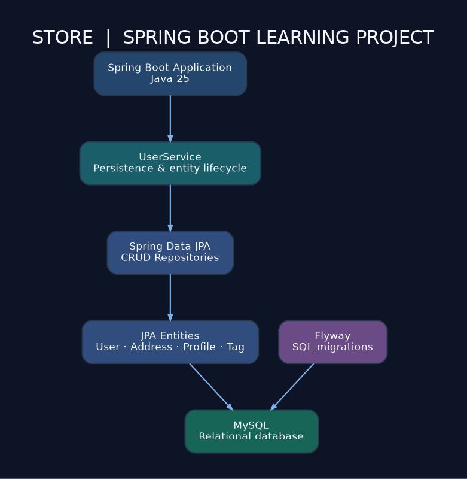
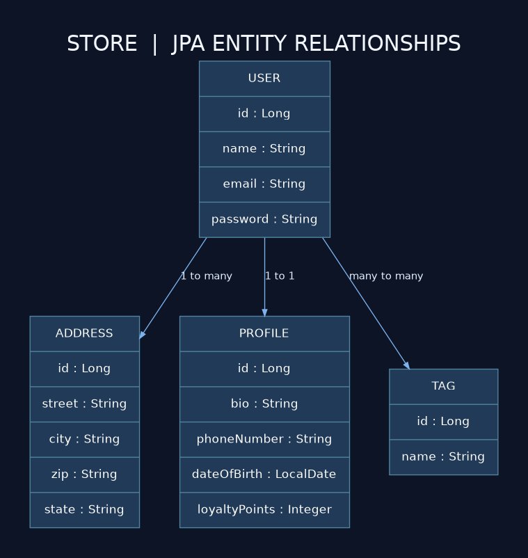

# Store — Spring Boot & JPA Practice Project

A Java backend learning project exploring **Spring Boot**, **Spring Data JPA**, **Hibernate**, **MySQL**, and relational entity mappings. This repository is a **practice project**, not a complete e-commerce application.



## What this project covers

- Mapping `User`, `Address`, `Profile`, and `Tag` as JPA entities.
- `OneToMany`, `OneToOne`, and `ManyToMany` relationships.
- CRUD repositories using Spring Data JPA.
- Entity persistence and lifecycle examples in `UserService`.
- MySQL connectivity and an initial Flyway SQL migration.
- A minimal static page returning **Hello world** (not a complete storefront).

## Entity relationships



> The diagram describes entity annotations in the Java source, not a verified live database schema.

## Tech stack

| Tool | Purpose |
| --- | --- |
| Java 25 | Programming language (as configured in `pom.xml`) |
| Spring Boot 4.1.1 | Application framework (as configured) |
| Spring Data JPA / Hibernate | ORM and repositories |
| MySQL | Database |
| Flyway | Database migrations |
| Lombok | Boilerplate reduction |
| Maven | Build and dependency management |

## Project structure

```text
src/
  main/
    java/com/mn/store/
      entities/       # User, Address, Profile, Tag
      repositories/   # JPA repository interfaces
      services/       # UserService examples
      StoreApplication.java
    resources/
      db/migration/   # Initial SQL migration
      static/         # Basic HTML page
      application.yaml
      application.properties
  test/               # Spring Boot context test
```

## Run locally

1. Install **JDK 25** and **MySQL**. Maven is available through the included Maven wrapper.
2. Create a MySQL account/database you can use locally. The JDBC URL in `application.yaml` contains `createDatabaseIfNotExist=true`; your MySQL user must have the necessary permissions.
3. Set your database credentials as environment variables (PowerShell example):

   ```powershell
   $env:DB_USERNAME = "root"
   $env:DB_PASSWORD = "YOUR_LOCAL_PASSWORD"
   .\mvnw.cmd spring-boot:run
   ```

4. The configured server port is **8081**. Try `http://localhost:8081/` to view the basic page.

**Note:** This code has not been tested end-to-end in this packaging step. The project has known issues to resolve before expecting a clean startup: the Flyway migration defines a table named `users`, whereas the `User` entity maps to `useres`; and several repository query-method names refer to properties not declared on `User`. Also, `ddl-auto: update` alongside Flyway can lead to schema management conflicts. These are useful next learning steps.

## Security notes

- Database passwords are read from `DB_PASSWORD` rather than committed into the configuration.
- **Never commit real passwords, API keys, `.env` files, or your local `.git` history from an archive.**
- User records currently contain a plain `password` field; do not use this example for real accounts without secure password hashing and appropriate authentication controls.
- The properties mentioning Stripe are configuration examples; **no working Stripe payment integration** is implemented here.

## Status & future improvements

This is an educational work-in-progress. Potential improvements include fixing derived repository queries, aligning migrations with the entity model, adding REST controllers and DTOs, writing tests, implementing password hashing, and separating development and production configuration.

## License

No license has been selected yet. Add a LICENSE file if you want others to have explicit permission to reuse the code.
